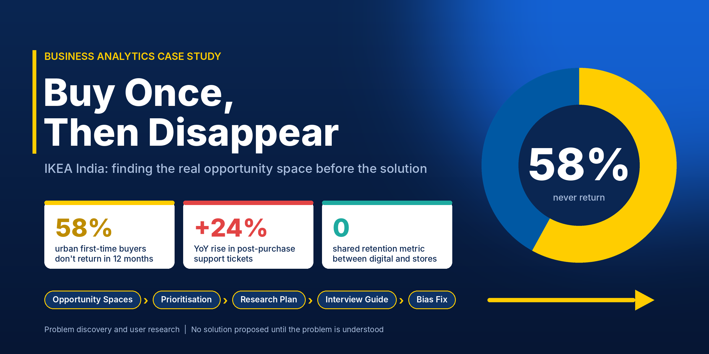

<h1 align="center">IKEA India — Buy Once, Then Disappear: A Problem Discovery & User Research Case Study</h1>

<p align="center">
  
  
  
  
</p>

<p align="center">
  
</p>

## Overview

IKEA entered India with stores in Hyderabad, Mumbai and Bengaluru, targeting urban middle-class buyers. First-purchase numbers looked strong, but repeat purchases did not follow. Management asked for an investigation into why, and for the real opportunity spaces, before any solution is proposed. The case study works through problem discovery → opportunity spaces → prioritisation → research design → bias check, using opportunity-space mapping, a prioritisation framework, qualitative user research and a sampling-bias critique.

## The Problem

| Signal | Value |
|---|---|
| Urban first-time buyers who don't return within 12 months | **58%** |
| Post-purchase support tickets (assembly issues, missing parts, delivery delays) | **+24% YoY** |
| Exit-survey feedback: "too far, too overwhelming, too effortful" | **Never formally analysed** |
| Shared retention metric between the digital team (sessions) and the store team (footfall) | **None** |
| Competitors picking up customers after their first IKEA visit | **Pepperfry, Urban Ladder** |

Nobody agrees on what is wrong and no structured research has been done, so the work starts by understanding the problem rather than solving it.

## Frameworks Applied

| Framework | Used for |
|---|---|
| Opportunity-space mapping | Turning symptoms in the data into deeper unmet customer needs |
| ICE prioritisation (Impact, Confidence, Ease) | Choosing which opportunity deserves attention first |
| Qualitative discovery research | Designing a small, purposeful plan to learn *why* customers don't return |
| Customer-journey interview guide | Covering the experience from first purchase to lapse |
| Sampling-bias critique | Challenging the "interview only positive reviewers" proposal and fixing it |

## Approach

1. **Opportunity Spaces** — Reframed each signal as an unmet need rather than a symptom (below).
2. **Prioritisation** — Scored the opportunities with ICE and picked one to investigate first.
3. **Research Plan** — Chose in-depth one-on-one interviews with lapsed buyers, with the reasoning and assumptions stated.
4. **Interview Guide** — Wrote the core questions that follow the customer from first purchase to why they never came back.
5. **Bias Check** — Called out the flaw in the positive-reviewers-only sample and designed the fix.

## Key Insights

- **The real problem is ownership, not the first sale** — The 24% YoY rise in assembly, missing-part and delivery tickets sits directly between the first purchase and the 58% who never return.
- **Effort is a theme running through the data** — Exit surveys call IKEA too far, too overwhelming and too effortful, and support tickets are about effort after purchase, so the same unmet need may show up before and after the sale.
- **Competitors win the second purchase** — Pepperfry and Urban Ladder pick up customers after their first IKEA visit, so the lapsed customer still needs furniture and is buying it elsewhere.
- **The organisation can't see the leak** — With sessions tracked by digital and footfall by stores, no one owns repeat purchase, which is why the 58% went unaddressed.

**Opportunity spaces identified**

| # | Unmet need | Evidence in the data |
|---|---|---|
| 1 | Effortless, confident ownership after purchase | +24% YoY support tickets on assembly, missing parts, delivery |
| 2 | Low-effort access to the store and range | Exit surveys: "too far, too overwhelming, too effortful" |
| 3 | Confidence when choosing from a large range | "Too overwhelming" feedback (a hypothesis, not yet analysed) |
| 4 | A reason and an easy path to come back | 58% lapse in 12 months; competitors capture the next purchase |

**Prioritisation (ICE, 1–10; scores are my own judgement and stated as assumptions)**

| Opportunity | Impact | Confidence | Ease | Average |
|---|---|---|---|---|
| 1. Effortless ownership after purchase | 9 | 8 | 6 | **7.7** |
| 4. Reason and path to come back | 7 | 5 | 7 | 6.3 |
| 2. Low-effort access | 8 | 5 | 4 | 5.7 |
| 3. Confidence when choosing | 6 | 4 | 6 | 5.3 |

**Opportunity 1 goes first**: it has the strongest evidence (a measured 24% rise), it happens right before customers lapse, and it can be investigated with customers IKEA already has records for. Opportunity 2 has the least evidence because its feedback has never been analysed, so a first step is to code the exit-survey comments.

**Research plan**

- **Method:** qualitative, one-on-one in-depth interviews, because the question is *why*, which numbers like the 58% cannot answer. A larger survey can follow later to size whatever the interviews uncover.
- **Sample (assumption: roughly 12–15 interviews):** lapsed urban first-time buyers across Hyderabad, Mumbai and Bengaluru, including those who raised a support ticket, those who didn't, those who bought from a competitor afterwards, and a few repeat buyers as a contrast group.

**Core interview questions**

1. Walk me through the day you decided to buy furniture, from the first idea to the purchase. How did you pick IKEA?
2. How did you get to the store, and how did the visit feel from start to finish?
3. What did you buy, and how did it reach your home?
4. Tell me about putting it together. What went smoothly, and what didn't?
5. Was anything missing, damaged or late? What did you do about it, and how did it turn out?
6. How did that experience change how you felt about IKEA?
7. When you needed furniture or home items again, what did you do? Where did you go and why?
8. Did you consider coming back to IKEA? What stopped you?
9. What would have to be different for IKEA to be your first choice next time?
10. Is there anything about your experience I haven't asked that you'd like to tell me?

**What is wrong with interviewing only positive reviewers, and the fix**

| The flaw | Why it matters | The fix |
|---|---|---|
| Survivorship and selection bias | People who left positive reviews are the engaged few, while the 58% who vanished are silent | Recruit from purchase records, not reviews |
| Missing the churned customers | The problem is people who did not return, and they are exactly who this sample leaves out | Interview lapsed buyers, with repeat buyers only as a contrast group |
| Confirmation bias | Happy customers confirm what management already believes and hide the assembly, delivery and effort pain | Include customers who filed tickets, gave low ratings or left no review |
| Reviews describe products, not the journey | The causes sit in delivery, assembly and access, not in the sofa | Use a neutral journey-based guide, not a product-focused one |

## Recommendations

| # | Recommendation |
|---|---|
| 01 | Start with the unanalysed exit-survey comments: code them into themes to test opportunities 2 and 3 |
| 02 | Investigate opportunity 1 (post-purchase ownership) first with the interview plan above |
| 03 | Sample lapsed buyers from purchase records, not positive reviewers, and include ticket-raisers and competitor switchers |
| 04 | Agree one shared retention metric (for example 12-month repeat purchase rate) across digital and store teams |
| 05 | Hold solution ideas until interviews confirm the cause, then size findings with a survey |

## Repository Structure

```
ikea-retention-case-study
├── IKEA_Case_Study.pdf    ← Full case study deck (add your file here)
├── cover.png              ← Repo cover image
└── README.md
```

---

## About Me

**Anmol Agarwal**
Business Analyst

[](https://www.linkedin.com/in/anmol-agarwal123/)
[](https://github.com/Anmolagarwal19)
[](mailto:agarwalanmol799@gmail.com)

*If this project was useful, a star on the repo is appreciated — feel free to reach out for feedback, questions, or opportunities.*
